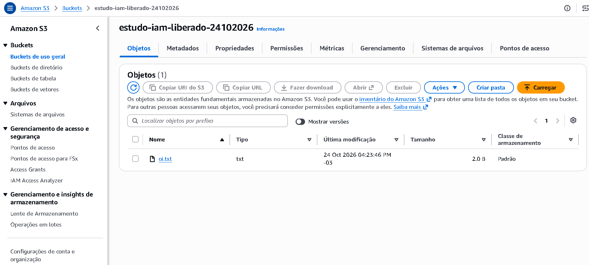
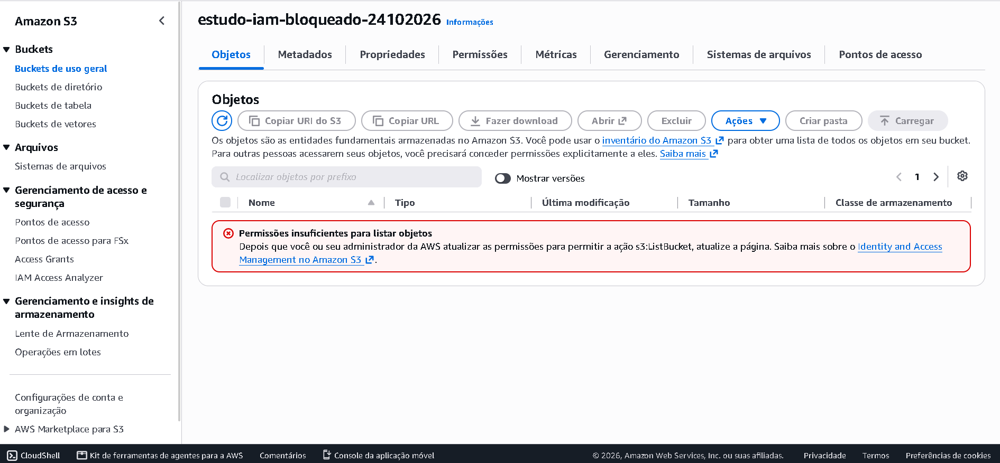
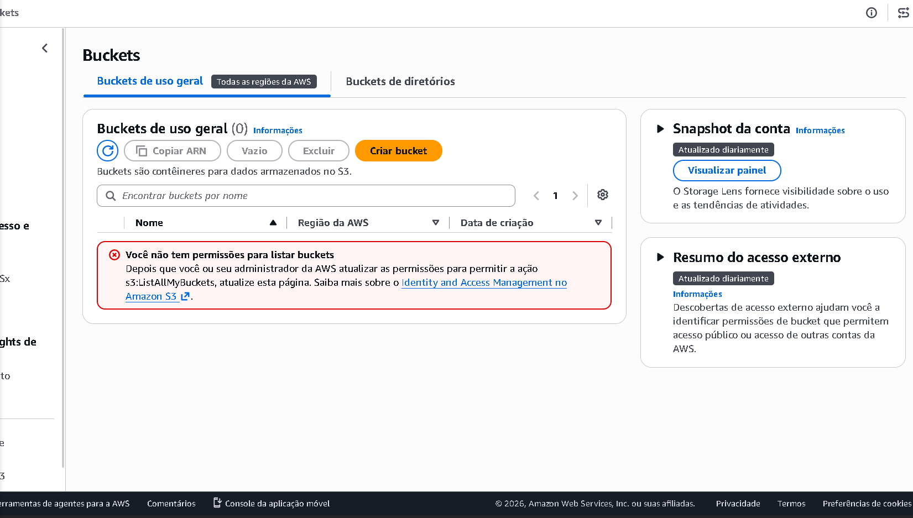

# AWS Infra Lab

Este é o meu laboratório pessoal para estudar infraestrutura e cloud na AWS, aprendendo
na prática. A ideia é simular o dia a dia de quem cuida de infraestrutura: revisar
permissões, monitorar serviços, automatizar tarefas repetitivas e documentar tudo
para que outra pessoa consiga seguir o passo a passo.

Vou atualizando o repositório conforme avanço, então ele também serve como um diário
do que estou aprendendo.

## Por onde já passei

- [x] Conta AWS com MFA no usuário root e alerta de gasto (AWS Budgets)
- [x] IAM: grupo, usuário de teste e policy dando acesso a um único bucket
- [x] Testes de acesso permitido e negado, com prints
- [ ] Credential Report e script Python para auditar usuários do IAM
- [ ] Alarme de CPU no CloudWatch avisando por e-mail
- [ ] Runbooks (guias curtos de "o que fazer quando...")

## IAM: dar só o acesso que a pessoa precisa

O exercício foi aplicar o princípio do menor privilégio: cada usuário deve ter apenas
as permissões necessárias para o seu trabalho, nada além disso.

**Como montei:**

1. Criei o grupo `leitores-s3` e o usuário `teste-leitura`, que pertence a esse grupo.
2. No primeiro teste, dei ao grupo a policy pronta `AmazonS3ReadOnlyAccess`. O usuário
   conseguia listar todos os buckets, mas era barrado ao tentar criar um
   (erro de `s3:CreateBucket`). Já era melhor que um acesso total, mas ainda amplo demais:
   ele enxergava buckets que não precisava.
3. Então escrevi uma policy própria, [`leitura-bucket-liberado`](iam/leitura-bucket-liberado.json),
   que permite apenas listar e ler os arquivos de **um** bucket específico, e troquei a
   policy do grupo por ela.

**Resultado dos testes** (sempre logado como `teste-leitura`):

| Teste | Esperado | Resultado |
|---|---|---|
| Listar e abrir arquivos do bucket liberado | Permitido | OK |
| Listar objetos do bucket bloqueado | Negado | OK |
| Listar todos os buckets da conta | Negado | OK |

## O que aprendi

- No IAM, tudo é negado por padrão. Só funciona o que alguma policy libera de forma explícita.
- Na policy, `ListBucket` age sobre o bucket em si, enquanto `GetObject` age sobre os
  arquivos dentro dele (por isso o `/*` no final do recurso). Misturar os dois é um erro
  fácil de cometer.
- Dar permissão por grupo é mais fácil de manter do que usuário por usuário.
- As mensagens de "acesso negado" da AWS dizem qual ação faltou, o que ajuda muito
  a investigar quando alguém diz "não consigo acessar".

## Evidências

Bucket liberado: o usuário consegue ver e abrir o arquivo.

Bucket bloqueado: acesso negado, como esperado.

Lista geral de buckets: também negada, já que o usuário só enxerga o que foi liberado.

## Próximos passos

Agora vou fazer uma revisão de permissões de verdade: gerar o Credential Report,
escrever um script em Python que encontra usuários sem MFA e chaves de acesso antigas,
e corrigir o que ele apontar. Depois entram o monitoramento com CloudWatch e os runbooks.
